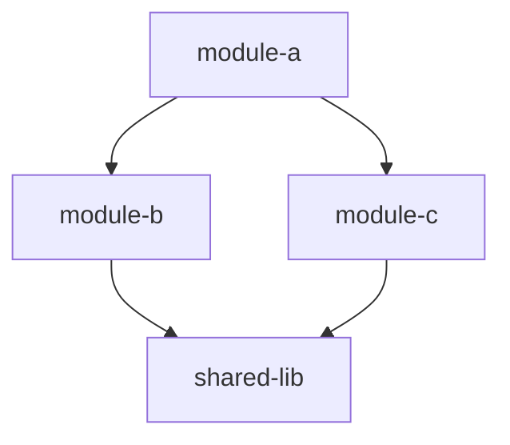
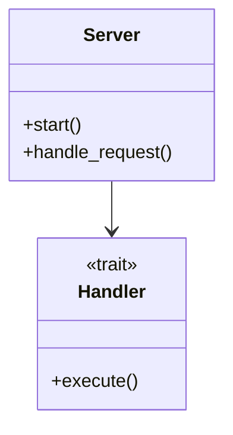
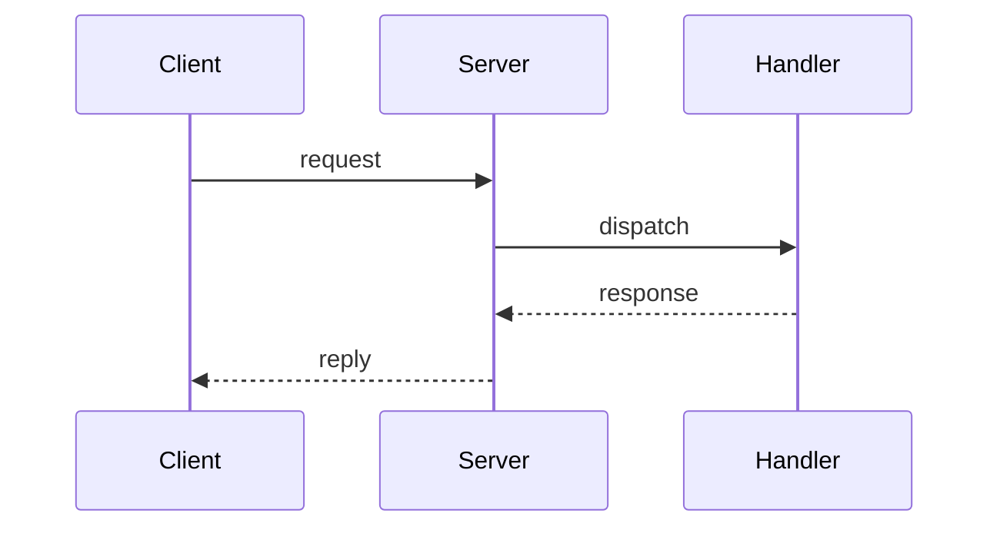
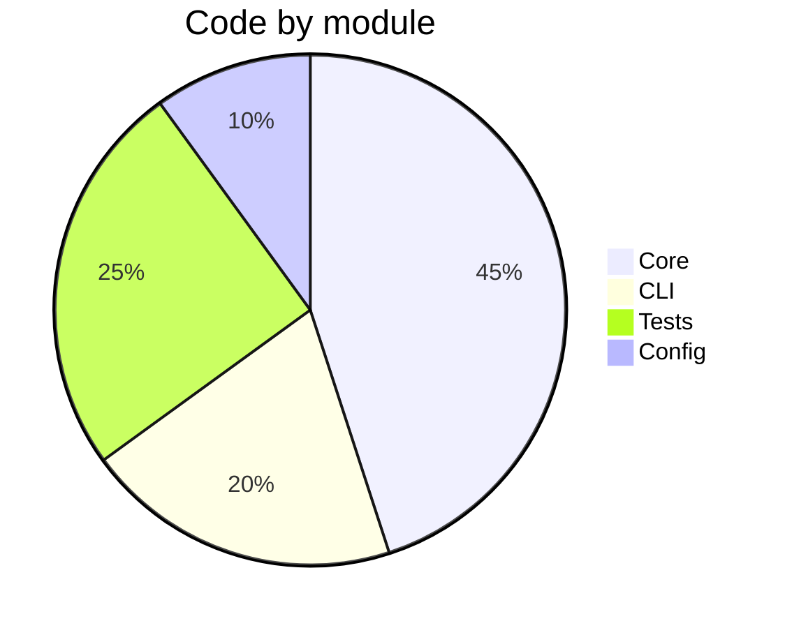

# Code Map

Write an overview of the architecture to `ARCHITECTURE.md` at the root of the repository, with Mermaid diagrams.

If the caller gives a scope, map only that directory or module:

```
$ARGUMENTS
```

## Process

Call the `tools.code_context` verbs in the `runCode` tool. The `code-analyzing` skill tells how they work.

### 1. Get the status of the index

```js
return await tools.code_context.getStatus({});
```

Do not wait for the index. Use the results that the index has now. In the summary, say which layers were not complete.

### 2. Get the structure

- **The projects:** `detectProjects({})` gives each project, its language, and its directory.
- **The size:** `getStatus({})` gives `totalFiles`, and the percent of the files that each index layer holds.
- **The entry points:** read the manifest of each project, for example `Package.swift`, `Cargo.toml`, `package.json`, `go.mod`, or `pyproject.toml`. Find the entry files, for example `main.swift`, `main.rs`, `lib.rs`, `index.ts`, or `main.go`.
- **The symbols of a module:** `listSymbol({ file: "<entry file>" })`.
- **The important types:** `searchSymbol({ query: "<domain word>", kind: "type", maxResults: 50 })`. Use the words of the project.
- **The calls from an entry point:** `getCallgraph({ symbol: "<entry point>", direction: "outbound", maxDepth: 2 })`.
- **The dependencies of a key file:** `getBlastradius({ file: "<key file>", maxHops: 2 })`.

If `getCallgraph` or `getBlastradius` gives nothing early in a session, call `getInboundCalls` at the entry points. It asks the language server, and it does not need the index.

### 3. Write `ARCHITECTURE.md`

Write these sections. Each section has a Mermaid diagram where one is possible.

**Header:**

```markdown
# Architecture

> Generated by `/code-map` — [timestamp]

## Overview

[Two or three sentences: what it is, what it does, the language and the framework.]
```

**Module dependencies** (`graph TD`). Put the modules in layers when the layers are clear, for example CLI → core → data:

````markdown

````

**Important types and their relations** (`classDiagram`). Show the 10 to 20 most important types:

````markdown

````

**Important flows** (`sequenceDiagram`). Show one to three important paths, for example a request, a data pipeline, or a build:

````markdown

````

**Composition of the code** (`pie`), by module:

````markdown

````

**Directory structure:** a tree of the top directories, with a short note for each one.

**Symbol index:** a table of the important public types and functions, by module:

```markdown
| Module | Symbol | Kind | Description |
|---|---|---|---|
| server | Server | struct | The main server |
| server | start | fn | The entry point |
```

### 4. Report

```
Wrote ARCHITECTURE.md

- [N] modules
- [N] important types
- [N] flows
- [N] Mermaid diagrams
- Index layers that were not complete: [list, or "none"]
```

## Rules

- Write to the root of the repository. Replace the file if it exists.
- Each diagram must be valid Mermaid that shows correctly on GitHub.
- Show the architecture, not the implementation.
- Each statement must come from a verb result. Do not guess.
- An empty call graph is not a fact about the code. Say which verb gave nothing, and draw the flows from the results that you have.
- For a workspace with many projects, show the workspace first, then the important projects.
- Keep the file shorter than 500 lines.
